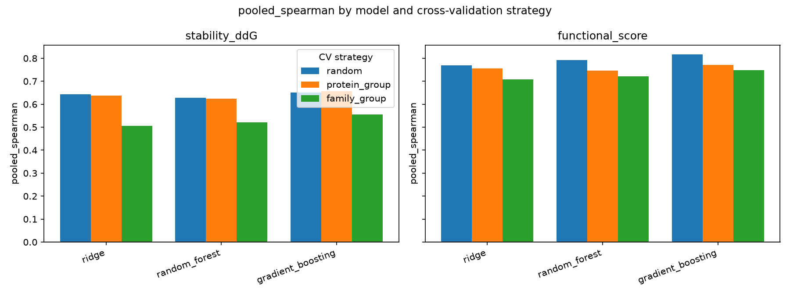
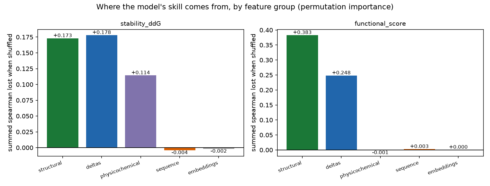

# AI-Guided Prioritization of Protein Mutations for Stability and Functional Retention

**Medvolt.AI — AI Research Scientist case study**
Dataset: `Protein_Mutation_Assignment_Dataset` (fully synthetic) · Random seed: `20261102`
Environment: Python 3.11.15, scikit-learn 1.9.1, PyTorch 2.15.0 · 786 automated tests, `ruff` and `mypy` clean
Extended version with full derivations and all candidate write-ups: `report/final_report_full.md`

---

## 1. Problem and Scientific Objective

A 300-residue protein admits 5,700 single-point substitutions; a wet-lab campaign can
characterise tens. The binding constraint is assay throughput, so the question is not "can we
predict mutation effects" but "which handful should enter the queue next".

That question is irreducibly **multi-objective**: a mutation must be thermodynamically tolerated
*and* retain function, and the two trade off — the most stabilizing substitutions often sit at
buried positions that disturb an active site. This system predicts `stability_ddG` (negative = stabilizing) and `functional_score` (1 =
wild-type-like) for unlabeled mutations, estimates **per-candidate uncertainty**, flags
out-of-distribution candidates, applies an absolute **viability gate**, and returns a ranked,
justified Top 10.

The emphasis throughout is **honest performance estimation**: for a system deciding which
molecules get synthesized, an over-optimistic score converts a modelling artefact into wasted
bench time. Section 4 shows the obvious validation choice inflates performance by up to 0.137
Spearman; Section 6 shows the most expensive feature block contributes almost nothing.

| Table | Rows | Proteins | Families |
|---|---|---|---|
| `labeled_mutations.csv` | 840 | 28 | 7 (PF01–PF07) |
| `candidate_mutations_unlabeled.csv` | 180 | 35 (8 unseen) | 9 (PF08, PF09 unseen) |
| `protein_embeddings.csv` | 36 | 36 | 9 |

Two structural facts drive every subsequent decision. **Mutations are nested within proteins,
proteins within families** — 840 mutations cover only 28 proteins, so rows are not independent.
And **the candidate set is partly out-of-distribution by construction**: 58 of 180 candidates
(32%) belong to families with no labeled examples at all.

---

## 2. Data and Preprocessing

Implemented in `src/data_processing.py`.

The mutation tables join to the embedding table on `protein_id` (many-to-one). The join is
verified, not assumed: cardinality is asserted, zero row loss is enforced (840 → 840, 180 → 180),
and vector alignment is re-checked element-wise after the merge — which catches a misaligned join
that preserved row counts.

The quality audit scans for nulls, infinities and range violations. **The dataset is clean: zero
missing, zero infinite, zero out-of-range values.** The handling policy is implemented and tested
anyway, because a clean dataset today is no guarantee for a refresh: a missing *target* drops the
row (imputing a label fabricates supervision); a missing *feature* takes the median fitted on
labeled data only; out-of-range values are logged but **not clipped**, since silent correction
hides data problems. Every action is recorded in `data/processed/feature_manifest.json`.

**Feature engineering.** Secondary structure (H/E/C) is one-hot encoded against a fixed category
list, so training and candidate matrices always share identical columns in identical order.
Physicochemical deltas are produced in both signed and absolute form: the signed delta carries
*direction* — a hydrophobic-to-polar change behaves differently in the core than on the surface —
while the absolute delta carries *magnitude of perturbation*, which a tree would otherwise need
two splits to express. Relative position makes sequence location comparable across proteins.
Anomaly handling runs **before** delta computation, so an imputed component yields a consistent
delta. Output: 22 tabular + 256 embedding features.

---

## 3. Modeling Approach

Architectures in `src/model.py`, `src/torch_model.py` and `src/torch_model_v2.py`; fold-wise
execution in `src/train.py` and `src/torch_training.py`.

Each target is modelled by independent single-target regression for the classical models.
Multi-output regression was rejected deliberately: the two targets have different scales,
different error structure and different achievable accuracy.

**Classical baselines.** Three model families — regularized linear (ridge), random forest and
gradient-boosted trees — were cross-validated on both targets under all three splitting strategies
and scored on MAE, RMSE, R², Pearson and Spearman. Every fold fits one scikit-learn `Pipeline`
from scratch:

```
ColumnTransformer
  ├─ tabular   (22 cols) : SimpleImputer(median) → StandardScaler
  └─ embedding (256 cols): SimpleImputer(median) → StandardScaler → PCA(16)
→ GradientBoostingRegressor
```

Because imputation, scaling and PCA are **steps inside the pipeline**, `fit` on the training fold
is the only place their statistics are learned. This is asserted, not assumed: fitted statistics
must equal the training fold's and *differ* from whole-table statistics, and corrupting validation
rows (features ×1000, targets −999) must leave every fitted object bit-identical.

**Neural networks.** Two PyTorch architectures were developed to test whether a learned joint
representation beats the trees, trained on the *same folds* with the *same* fold-local
preprocessing so any difference measures the model rather than the plumbing.

*Multitask network* — one shared backbone (256→128→64, each `Linear → BatchNorm → ReLU →
Dropout`) feeding two heads: stability unbounded, function through a **sigmoid** so the 0–1 bound
holds by construction rather than by hope. The motivation for sharing is that both targets are
driven by the same physical question — how much the substitution perturbs its local environment.

*Dual-branch network* — motivated by the ablation finding in Section 6. The tabular block and the
embedding block travel separate paths and meet only after each is processed: tabular through
128→64, the 256-d embedding squeezed through a learned 32-d bottleneck, concatenated into a
fusion trunk with two residual blocks. The learned bottleneck **replaces** the fold-local PCA,
because PCA maximises retained variance, which in a protein-level vector is largely variance
*between* families — precisely the component that cannot transfer to a held-out family.

Both networks early-stop on an **inner** validation split carved out of the training fold and
grouped the same way the outer split is. Stopping on the outer fold would select the epoch
scoring best on the very rows used to report performance, so there are **two leakage boundaries
here, not one**.

**Model selection** used pooled out-of-fold Spearman under `family_group`, chosen because the
deliverable is a *ranking*: Spearman measures the ordering quality Top-10 selection depends on,
while RMSE would reward calibration the downstream task never uses. Pearson is reported beside it
so poor calibration stays visible rather than hidden behind a good ranking.

---

## 4. Validation Strategy

Implemented in `src/validation.py`.

**The leakage mechanism.** Standard $K$-fold partitions the 840 mutations at random, so for almost
every fold there are training and validation rows from the *same protein*. The model can then
score well by recognising the protein rather than learning the effect of the substitution — and
the protein embedding, being constant within a protein, is a perfect protein identifier.

Three nested regimes were implemented: `random`, `protein_group` (unseen protein, seen family)
and `family_group` (unseen family — the candidates' regime). Every fold set is verified before
use — each row validated exactly once, no row on both sides, no shared group — and a violation
raises `LeakageError` rather than a quietly optimistic number. **Empirical leakage:**

| Strategy | Val rows/fold | Proteins on both sides | Families on both sides |
|---|---|---|---|
| `random` | 168 (exactly) | **28 of 28** | **7 of 7** |
| `protein_group` | 155–183 | 0 | up to 5 |
| `family_group` | 106–246 | 0 | 0 |

Random $K$-fold places *every* protein and *every* family on both sides of *every* fold: the
leakage is not marginal, it is total.

**The optimism gap** — pooled out-of-fold Spearman for the selected gradient-boosted model:

| Target | `random` | `protein_group` | `family_group` | Gap |
|---|---|---|---|---|
| `stability_ddG` | 0.650 | 0.656 | **0.556** | **+0.094** |
| `functional_score` | 0.817 | 0.771 | **0.747** | **+0.070** |

Across all models the gap reaches **+0.137** (ridge, stability). Generalising to a new protein
within a *known* family is nearly free (`protein_group` ≈ `random`); generalising to a new
*family* is where performance is actually lost — precisely the regime of 32% of the candidates.
`family_group` is therefore the **primary** strategy for model selection, the ablation and all
headline figures.

One caveat: with only 7 labeled families, 5-fold grouping yields 1–2 held-out families per fold
and uneven fold sizes (106–246 rows). All headline metrics are therefore **pooled across all
out-of-fold predictions** rather than averaged over folds, which weights every mutation equally.



---

## 5. Results

Selected model for both targets: **gradient boosting**, pooled out-of-fold under `family_group`:

| Target | MAE | RMSE | R² | Pearson | Spearman | Fold SD (Spearman) |
|---|---|---|---|---|---|---|
| `stability_ddG` | 0.338 | 0.426 | 0.341 | 0.598 | 0.556 | 0.052 |
| `functional_score` | 0.055 | 0.069 | 0.634 | 0.796 | 0.747 | 0.031 |

**Functional retention is substantially more predictable than stability** (R² 0.63 vs 0.34). With
RMSE 0.426 on a target whose predicted range is −0.149 to +1.41, the model resolves *coarse*
stability ordering but cannot distinguish candidates differing by less than roughly
0.4 kcal/mol.

**All five models, same folds, pooled Spearman under `family_group`:**

| Model | Family | `stability_ddG` | `functional_score` |
|---|---|---|---|
| **Gradient boosting** | boosted trees | **0.556** | **0.747** |
| Random forest | bagged trees | 0.522 | 0.721 |
| Ridge | linear | 0.507 | 0.708 |
| Multitask NN | neural | 0.551 | 0.218 |
| Dual-branch NN | neural | 0.390 | 0.282 |

**Neither network beats the trees, and the reason is instructive.** The multitask network is
effectively tied with the best baseline on stability (0.551 vs 0.556) but collapses on function,
where R² = −0.677 is *worse than predicting the training mean*. The diagnostic is visible in the
residuals: its function predictions compress into a narrow band around 0.60–0.65 with a mean
residual of −0.095, while the baseline's track the identity line. The unbounded stability target
dominates the shared gradients because a 0–1 function target produces a roughly 30× smaller MSE.

The dual-branch architecture was built to test whether disentangling the embedding fixes this. It
recovers function (R² −0.677 → −0.002) at the cost of stability (0.551 → 0.390); a controlled 2×2
of architecture against loss weighting showed neither change alone suffices and that the two
interact. On 840 rows and 7 families this is the expected outcome, and it is reported as such
rather than tuned until a network wins. Learning curves confirm the networks trained correctly:
inner-validation loss bottoms out and climbs, and early stopping fires on every fold well before
`max_epochs`.

---

## 6. Ablation and Interpretation

Two independent methods were used to answer *what information contributed most*: removing feature
groups and refitting (`src/ablation.py`), and permuting feature groups in the already-fitted
production model (`src/attribution.py`). They agree.

**Ablation.** Each subset is cross-validated from scratch under `family_group` with folds, seed
and model held fixed, so differences are attributable to features alone. Pooled out-of-fold
Spearman, with change against the full model:

| Subset | Features | `stability_ddG` | Δ | `functional_score` | Δ |
|---|---|---|---|---|---|
| **D_full** | 22 + 256 | **0.556** | — | **0.747** | — |
| E_all_tabular_no_embeddings | 22 + 0 | 0.546 | −0.010 | 0.723 | −0.025 |
| F_full_minus_deltas | 16 + 256 | 0.536 | −0.021 | 0.717 | −0.030 |
| G_full_minus_structural | 15 + 256 | 0.413 | −0.143 | 0.370 | −0.377 |
| A_tabular_no_embeddings | 9 + 0 | 0.373 | −0.183 | 0.271 | −0.477 |
| B_embeddings_only | 0 + 256 | **−0.205** | −0.762 | **−0.110** | −0.857 |

(Subset C, tabular+embeddings without the structural block, sits between G and A; full table in
`results/metrics/ablation_summary.md`.)

**Feature attribution.** Permutation importance measured on *held-out* fold rows — Spearman lost
when a column is shuffled, averaged over the five folds. The 256 embedding columns are shuffled
**as one block**, since they are a single protein-level vector and permuting them individually
would under-report them by construction:

| Feature group | `stability_ddG` | `functional_score` |
|---|---|---|
| structural | +0.173 | **+0.383** |
| deltas | **+0.178** | +0.248 |
| physicochemical | +0.114 | −0.001 |
| sequence | −0.004 | +0.003 |
| **embeddings (all 256)** | **−0.002** | **+0.000** |

Strongest individual features: `solvent_accessibility` (+0.108) and `delta_hydrophobicity`
(+0.107) for stability; `distance_to_active_site` (+0.314, alone twice the next) for function.

**(1) The structural microenvironment carries almost all the signal.** Removing it costs −0.143
and −0.377 in ablation, and it is the largest permutation group for function — conservation,
accessibility and active-site distance describe the local constraint the substitution must
satisfy.

**(2) The 256-dimensional embeddings contribute essentially nothing, and alone are worse than
useless.** Adding them to the full tabular set buys +0.010 and +0.025; used alone they give
**negative** rank correlation (−0.205, −0.110); and permuting the whole block in the fitted model
moves the score by −0.002 and +0.000, within noise of zero. The reason is structural, not a bug:
the embedding is a **per-protein constant**, identical for every mutation within a protein. It
cannot discriminate between mutations in the same protein — the actual task — and can only shift
a family-level baseline, which under family-grouped CV is unseen. **Subset E (22 features, no
embeddings, no PCA) performs within 0.01–0.03 Spearman of the full 278-feature model** at a
fraction of the cost.

That two methods with different failure modes — one refits, one does not — reach the same
conclusion is what makes it safe to act on.

**(3) Engineered delta features earn their place**, ranking *first* for stability by permutation
(+0.178) while costing only −0.021 in ablation. That gap is the signature of correlated features
the model can partly recover from when they are removed, but genuinely relies on when present.



---

## 7. Mutation Prioritization

Implemented in `src/predict.py`.

The five `family_group` fold pipelines per target form an ensemble; the mean is the point estimate
and the sample standard deviation ($K-1$) is the uncertainty. Each fold model carries its own
fitted imputer, scaler and PCA, so no transformer is reused across folds.

**Ranking strategy — a soft score under a hard gate.** Objectives are rank-normalised within the
candidate pool, oriented so higher is better, then combined:

$$\text{priority}(c) = w_{\text{stab}}\,\widetilde{(-\Delta\Delta G)}(c) + w_{\text{func}}\,\widetilde{S_{\text{func}}}(c) - \lambda\,\widetilde{u}(c), \qquad u(c) = \sqrt{s_{\text{stab}}^2 + s_{\text{func}}^2}$$

with $w_{\text{stab}} = w_{\text{func}} = 0.5$ and $\lambda = 0.25$. Uncertainties combine in
quadrature, and the penalty applies to the *normalised* uncertainty so it is commensurate with the
objective terms.

That score is **relative**: normalisation guarantees something scores near 1.0 even if every
candidate is predicted destabilizing. A **viability gate** supplies the absolute judgement a
relative score cannot — a candidate is viable only if predicted both stabilizing (ddG ≤ 0) **and**
functional (retention ≥ 0.7). Viability sorts *before* the score, so a viable candidate outranks
every non-viable one regardless of score.

**Only 5 of 180 candidates clear the gate** (116 fail stability alone, 59 fail both). The
shortlist below therefore shows 5 viable candidates followed by the 5 highest-scoring non-viable
ones, each labelled. Ranks 6–10 are **not wet-lab ready**; they are shown because excluding them
would silently return a Top 5.

**A negative result that matters.** Ensemble spread does **not** detect distribution shift:

| Flag | n | Mean $s_{\text{stab}}$ | Mean $s_{\text{func}}$ |
|---|---|---|---|
| `in_distribution` | 122 | 0.1031 | 0.0160 |
| `unseen_family` | 58 | **0.0969** | **0.0146** |

Fold disagreement is *slightly lower* for out-of-distribution candidates: the five fold models
agree with one another on novel families while potentially all being wrong together — exactly the
shared error a disagreement-based estimate cannot see. **The uncertainty penalty therefore does
not protect against domain shift; only the explicit `ood_flag` does.**

### Final Top 10

| Rank | Mutation | Family | Sub. | SS | ddG ± s | Func ± s | Score | Viability |
|---|---|---|---|---|---|---|---|---|
| 1 | CAND0148 | PF06 | S490L | H | −0.013 ± 0.085 | 0.861 ± 0.027 | 0.850 | **pass** |
| 2 | CAND0162 | PF03 | Y12F | C | **−0.149 ± 0.038** | 0.800 ± 0.013 | 0.833 | **pass** |
| 3 | CAND0167 | PF03 | N133S | C | −0.068 ± 0.125 | 0.854 ± 0.013 | 0.750 | **pass** |
| 4 | CAND0015 | PF03 | E353V | C | −0.076 ± 0.089 | 0.750 ± 0.014 | 0.631 | **pass** |
| 5 | CAND0126 | PF06 | Q360F | C | −0.019 ± 0.156 | 0.798 ± 0.012 | 0.619 | **pass** |
| 6 | CAND0002 | PF02 | M496W | E | +0.235 ± 0.040 | 0.878 ± 0.013 | 0.885 | fails stability |
| 7 | CAND0034 | PF01 | W11Y | C | +0.252 ± 0.020 | 0.865 ± 0.014 | 0.865 | fails stability |
| 8 | CAND0121 | PF02 | I66V | H | +0.172 ± 0.078 | 0.885 ± 0.006 | 0.846 | fails stability |
| 9 | CAND0159 | PF01 | C14V | E | +0.111 ± 0.070 | 0.851 ± 0.006 | 0.842 | fails stability |
| 10 | CAND0175 | PF05 | C475M | C | +0.263 ± 0.060 | 0.905 ± 0.007 | 0.835 | fails stability |

Protein identifiers and all remaining fields are in `results/mutation_rankings/top_10_candidates.csv`.

Rank 6 carries a *higher* raw score (0.885) than rank 1 (0.850). That is the gate working as
intended: viability is a hard constraint and the score is a soft preference.

**No out-of-distribution candidate reached the Top 10**, despite 32% of the pool being
unseen-family. That is favourable for reliability, but it is an emergent property of the scoring,
not an enforced constraint: if exploring novel families is a campaign goal, those candidates must
be requested explicitly from `candidate_predictions.csv`.

**Reading the leading candidates.** **Rank 2, CAND0162 (Y12F)** is the only shortlisted candidate
whose stabilizing prediction is *resolved* — its magnitude (−0.149) is about four times its spread
(0.038). Y→F removes a hydroxyl while preserving the aromatic ring, so it is near-isosteric
(Δvolume −3.7 ų); at a nearly fully exposed position (SASA 0.940) this raises hydrophobicity
without disturbing packing. **Rank 1, CAND0148** needs the most careful reading: its ddG magnitude
is roughly six times *smaller* than its own spread, so the sign is **not resolved** — the honest
statement is "approximately neutral", and it is the entry most in need of measurement rather than
trust. **Rank 5, CAND0126** (±0.156 against an effect of −0.019) reads the same way.

The top candidates share low-to-moderate conservation and moderate-to-high exposure: the model has
learned *perturb loosely constrained, exposed positions*, the heuristic an engineer would apply
manually. One caution — predicted retention spans only 0.750–0.905 across the Top 10, close to
that target's own RMSE (0.069), so **single-rank ordering should not be over-read**. The
defensible claim is that these ten are collectively better than the rest of the pool, and that the
first five are the only ones clearing an absolute bar.

---

## 8. Limitations

Every number describes a **synthetic** dataset; the relationships are generator artefacts and no
biophysical conclusion transfers. What transfers is the methodology.

**Seven labeled families is too few for stable family-grouped CV.** Folds hold 1–2 families each,
so a ±0.05 Spearman difference should not be over-interpreted — which is why the 0.005 gap between
gradient boosting and the multitask network on stability is not treated as real.

**Stability is only coarsely predicted** (R² 0.34); differences below ~0.4 kcal/mol are
unresolved. This directly limits the shortlist: three of the five viable candidates have a
predicted effect smaller than their own uncertainty.

**Uncertainty is underestimated and pool-relative.** Ensemble spread quantifies model
disagreement, not total predictive error, and the table above shows it is *blind to domain
shift* — the one regime where it is most needed. Priority scores rank within the submitted pool
rather than measuring absolute merit; the viability gate mitigates this but its thresholds are a
judgement call, not a calibrated decision boundary.

**Attribution has known blind spots.** Permutation importance under-reports correlated features —
why the delta block ranks first by permutation but shows a small ablation effect — and impurity
importance is computed on training rows and post-PCA inputs. Neither is a per-prediction
explanation; SHAP would be required for that, and was not computed.

**Results are environment-sensitive.** Two runs in one environment agree to floating-point
tolerance (6.7e-16) rather than byte-for-byte, and a scikit-learn change reorders the Top 10.
Pinned versions and seed are in `results/models/training_metadata.json`.

---

## 9. Future Research Direction

*First, replace the per-protein embedding with a mutation-aware representation.* The embedding's
failure is entirely explained by its being constant within a protein — demonstrated twice, by
ablation and by permutation. Per-*residue* representations from an ESM-style protein language
model give a position-specific vector, and the standard mutation-effect signals — wild-type-versus-mutant
log-odds at the mutated position, and pseudo-log-likelihood difference — are strong zero-shot
predictors precisely because they vary per mutation. This addresses the bottleneck the evidence
identified rather than adding capacity elsewhere, and it is also the change most likely to make
the neural architectures competitive: both networks are currently asked to learn from a feature
block that carries no within-protein signal.

*Second, structure-aware modelling.* The structural block dominates both the ablation and the
attribution, so better structural features are the most promising axis: with AlphaFold or ESMFold
structures, a graph neural network over the residue contact graph with the mutated residue as
query node would capture packing that `solvent_accessibility` and `distance_to_active_site` only
approximate. The dual-branch architecture is already the right shape — replace the embedding
branch with a structural encoder.

*Third, honest uncertainty.* Replace fold disagreement with something sensitive to domain shift —
deep ensembles, evidential regression, or conformal prediction for calibrated intervals — plus a
distance-to-training-data measure giving a continuous OOD score rather than a binary flag. This
would also turn the viability gate into a calibrated probability rather than a hard threshold.

*Fourth, validation at scale and active learning.* With more families, leave-one-family-out CV
would give a far more stable estimate, and nested CV would remove the optimistic bias of tuning on
the selection metric. Active learning requires the improved uncertainty first: an acquisition
function blind to novelty would systematically under-explore the novel families the campaign most
needs to learn about.

*Fifth, experimental integration.* The viability gate's thresholds are currently config values.
With even a small round of measured outcomes they could be fitted — turning the gate from a stated
preference into an estimated decision boundary, and giving the first real test of whether the
ranking transfers off the synthetic generator.

---

## Appendix: reproducing these results

```bash
python3.11 -m venv .venv && source .venv/bin/activate
pip install -r requirements-dev.txt
python -m pytest -q                            # 786 tests
python main.py --config config/config.yaml     # whole pipeline, ~126 s
python report/build_pdf.py                     # regenerate this PDF from its Markdown source
```

Each of the ten stages also runs alone as `python -m src.<stage>`, and `main.py --from <stage>`
resumes from any point; `python -m src.api` serves the trained model over HTTP. Requires Python
≥ 3.11. All configuration lives in `config/config.yaml`, dataset facts in
`src/common/constants.py`, engineering standards in `docs/CODING_GUIDELINES.md`.
