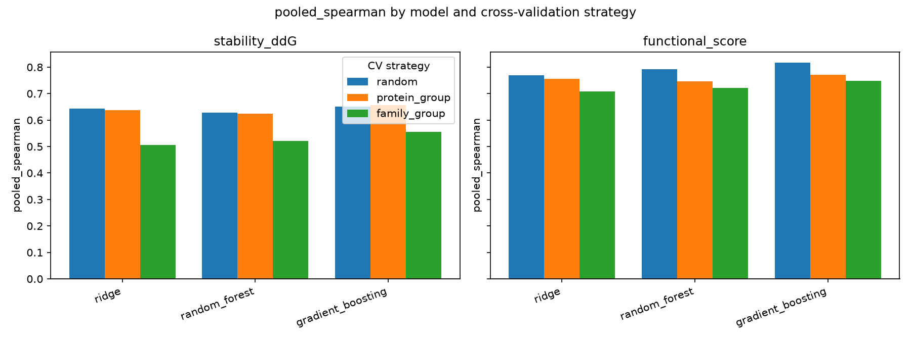
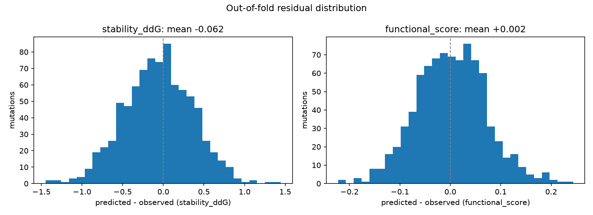

# AI-Guided Prioritization of Protein Mutations for Stability and Functional Retention

**Medvolt.AI — AI Research Scientist case study**
Dataset: `Protein_Mutation_Assignment_Dataset` (fully synthetic)
Random seed: `20261102` · Environment: Python 3.11.15, scikit-learn 1.9.1, numpy 2.4.6, scipy 1.17.1
Code: `medvolt_protein_engineering/` · 428 automated tests, `ruff` and `mypy` clean

---

## 1. Problem and scientific objective

Protein engineering campaigns face a combinatorial search problem. A 300-residue protein admits
5,700 single-point substitutions; a wet-lab campaign can characterise tens. The binding constraint
is not ideas but assay throughput, so the practical question is not "can we predict mutation
effects" but "which handful of mutations should enter the queue next".

That question has two objectives that trade off against each other. A mutation must be
**thermodynamically tolerated** — it must not unfold the protein — and it must **retain function**.
Optimising either alone fails: the most stabilizing substitutions are frequently at buried
positions where they disturb an active site, while the most functionally conservative changes are
often thermodynamically neutral and therefore uninteresting. A useful prioritization must
therefore be explicitly multi-objective.

This study builds an end-to-end system that:

1. predicts `stability_ddG` (negative = stabilizing) and `functional_score` (0 = severe loss,
   1 = wild-type-like) for unlabeled single-point mutations;
2. estimates **per-candidate uncertainty**, not just a point estimate;
3. flags candidates that fall outside the training distribution; and
4. returns a ranked, justified Top 10 for experimental follow-up.

The emphasis throughout is on **honest performance estimation**. For a system whose output
decides which molecules get synthesized, an over-optimistic validation score is worse than a
pessimistic one: it silently converts a modelling artefact into wasted bench time. Section 3
shows that the obvious validation choice here inflates performance by up to 0.14 Spearman, and
Section 5 shows that the most expensive feature block contributes almost nothing.

### 1.1 Data at a glance

| Table | Rows | Proteins | Families |
|---|---|---|---|
| `labeled_mutations.csv` | 840 | 28 | 7 (PF01–PF07) |
| `candidate_mutations_unlabeled.csv` | 180 | 35 (8 unseen) | 9 (PF08, PF09 unseen) |
| `protein_embeddings.csv` | 36 | 36 | 9 |

Two structural facts about this dataset drive every subsequent design decision:

- **Mutations are nested within proteins, and proteins within families.** The 840 labeled
  mutations cover only 28 proteins. Rows are therefore not independent.
- **The candidate set is partly out-of-distribution by construction.** 58 of 180 candidates
  (32%) belong to families PF08 and PF09, which have no labeled examples at all.

Any validation scheme that ignores the first fact will overstate performance; any prioritization
that ignores the second will present extrapolations as though they were interpolations.

---

## 2. Data, preprocessing and quality control

Implemented in `src/data_processing.py` (58 tests).

### 2.1 Relational schema and join

Mutation tables join to the embedding table on `protein_id` (many-to-one). The join is not
assumed correct; it is verified:

- **Cardinality** is asserted via `validate="many_to_one"`, so a duplicated protein row would
  raise rather than silently multiply mutation rows.
- **Zero row loss** is enforced: 840 → 840 and 180 → 180. A candidate protein without an
  embedding raises under `quality.fail_on_row_loss_in_merge`.
- **Vector alignment** is checked after the merge by re-indexing the source embeddings and
  comparing arrays element-wise, which catches a misaligned join that preserved row counts.
- **Shared-column consistency**: `protein_family` and `protein_length` appear in both tables and
  are confirmed to agree per protein before one copy is dropped.

### 2.2 Quality control findings

The audit (`inspect_anomalies`) scans for nulls, infinities and violations of the documented
ranges in `README_DATASET.txt` (conservation and solvent accessibility in [0,1], confidence
≈50–99, non-negative distances). **The dataset is clean: zero missing, zero infinite, zero
out-of-range values** in both tables.

The handling policy is nonetheless implemented and tested, because a clean dataset today is not a
guarantee for a refresh:

| Anomaly | Policy | Rationale |
|---|---|---|
| ±inf | → NaN, then imputed | An infinite physicochemical value is never meaningful and breaks scalers. |
| Missing target | **Row dropped**, counted | Imputing a label fabricates supervision signal. |
| Missing feature | Median, fit on labeled data only | Candidates must not influence training statistics; median resists skew. |
| Out of range | Logged and reported, **not clipped** | Values may be real signal; silent correction hides data problems. |

Every action is recorded in `data/processed/feature_manifest.json`, so a reviewer can see what
was altered without re-reading the code.

### 2.3 Feature engineering

**Secondary structure** (H/E/C) is one-hot encoded against a fixed category list, so the training
and candidate matrices always share identical columns in identical order even when a category is
absent from one. An unrecognised code yields an all-zero row plus a warning rather than a silent
mis-mapping.

**Physicochemical deltas** capture the biochemical shift the substitution imposes:

$$\Delta_{\text{property}} = \text{property}_{\text{mutant}} - \text{property}_{\text{wild-type}}$$

for hydrophobicity, formal charge and residue volume. Both signed and absolute forms are
produced. The signed delta carries *direction* — a hydrophobic-to-polar change behaves very
differently in the core than on the surface — while the absolute delta carries *magnitude of
perturbation*, which a tree model would otherwise need two splits to express. **Relative
position** (`position / protein_length`) makes sequence location comparable across proteins of
different length.

Anomaly handling runs **before** delta computation, so an imputed component yields a consistent
delta rather than a delta computed from a missing value.

Output: 22 tabular features + 256 embedding features, with the column lists recorded in the
manifest so no downstream stage re-derives them.

---

## 3. Validation strategy and leakage prevention

Implemented in `src/validation.py` (46 tests).

### 3.1 The leakage mechanism

Let mutation $i$ belong to protein $p(i)$ and family $f(p(i))$. Standard $K$-fold partitions the
840 mutations at random, so for almost every fold there exist $i \in \text{train}$ and
$j \in \text{validation}$ with $p(i) = p(j)$. The model can then score well on $j$ by recognising
the protein rather than by learning the effect of the substitution — the protein embedding is
**constant within a protein**, making it a perfect protein identifier.

Three nested regimes were therefore implemented and compared:

| Strategy | Grouping | Question it answers |
|---|---|---|
| `random` | none | Optimistic reference only |
| `protein_group` | `protein_id` | Transfer to an unseen protein in a *seen* family |
| `family_group` | `protein_family` | Transfer to an unseen *family* — the candidates' regime |

Every generated fold set is verified before use: each row is validated exactly once, no row
appears in both sides of a fold, and grouped strategies share no group across the split. A
violation raises `LeakageError` rather than producing a quietly optimistic number.

### 3.2 Empirical leakage

Measured on the labeled set (`results/metrics/cv_fold_summary.csv`):

| Strategy | Val rows/fold | Proteins on both sides | Families on both sides | Val families/fold |
|---|---|---|---|---|
| `random` | 168 (exactly) | **28 of 28** | **7 of 7** | 7 |
| `protein_group` | 155–183 | 0 | up to 5 | 4–5 |
| `family_group` | 106–246 | 0 | 0 | 1–2 |

Random $K$-fold places **every** protein and **every** family on both sides of **every** fold.
The leakage is not marginal; it is total.

### 3.3 The optimism gap

Pooled out-of-fold Spearman for the selected gradient-boosted model:

| Target | `random` | `protein_group` | `family_group` | Gap (random − family) |
|---|---|---|---|---|
| `stability_ddG` | 0.650 | 0.656 | **0.556** | **+0.094** |
| `functional_score` | 0.817 | 0.771 | **0.747** | **+0.070** |

Across all three models the gap reaches **+0.137** (ridge, stability). Interpretation:

- **Generalising to a new protein within a known family is nearly free.** `protein_group` ≈
  `random` for stability (0.656 vs 0.650). Family-level information is what the model relies on.
- **Generalising to a new family is where performance is actually lost**, and that is precisely
  the regime of 32% of the candidates.

`family_group` is therefore the **primary** strategy: model selection, the ablation and all
headline figures use it. Random splits are reported only to quantify the optimism they introduce.

### 3.4 A caveat on the family-grouped estimate

With only 7 labeled families, 5-fold family grouping yields 1–2 held-out families per fold and
markedly uneven fold sizes (106–246 rows, a 2.3× imbalance). Per-fold scores are consequently
noisy. All headline metrics are therefore **pooled across all out-of-fold predictions** rather
than averaged over folds: pooling weights every mutation equally and also penalises differences
in baseline level between families, which is what ranking candidates across families demands.
Per-fold mean and standard deviation are reported alongside for transparency
(`fold_std_spearman` ≈ 0.03–0.06).



---

## 4. Modelling approach and architecture

Architecture in `src/model.py` (16 tests); fold-wise execution and artifacts in
`src/train.py` (14 tests); metrics, selection and the optimism gap in `src/evaluate.py`
(22 tests).

### 4.1 Fold-local pipeline

Each of the two targets is modelled by independent single-target regression. Multi-output
regression was rejected deliberately: `stability_ddG` and `functional_score` have different
scales, different error structure and — as Section 5 shows — different achievable accuracy, and
nothing in the task requires a shared representation.

Every fold fits one scikit-learn `Pipeline` from scratch:

```
ColumnTransformer
  ├─ tabular   (22 cols) : SimpleImputer(median) → StandardScaler
  └─ embedding (256 cols): SimpleImputer(median) → StandardScaler → PCA(16)
→ GradientBoostingRegressor
```

Because imputation, scaling and PCA are **steps inside the pipeline**, `fit` on the training fold
is the only place their statistics are learned; the validation fold reaches `predict` only. This
is the central leakage guarantee, and it is asserted directly rather than assumed:

- The fitted imputer, scaler and PCA statistics are compared against the training-fold rows and
  confirmed equal — and confirmed *different* from whole-table statistics, so the test has teeth.
- Multiplying validation features by 1000 and setting validation targets to −999 leaves every
  fitted transformer and every model coefficient bit-identical.

Embeddings are standardised before PCA so no single dimension dominates the components. PCA is
fitted per fold, never globally. A warning fires when `n_components` approaches the number of
distinct training proteins, since the embedding block's rank is bounded by that count.

### 4.2 Model selection

Three candidates were cross-validated: ridge (linear baseline), random forest, and gradient-boosted
trees. Selection used **pooled out-of-fold Spearman under `family_group`**, chosen because the
deliverable is a *ranking*: Spearman measures the ordering quality that Top-10 selection actually
depends on, while RMSE would reward calibration that the downstream task never uses.

Pearson is reported alongside Spearman so that poor calibration stays visible rather than hidden
behind a good ranking: a model can order candidates perfectly while systematically mis-scaling the
magnitudes, and only Pearson and RMSE would show it.

Gradient boosting won both targets. Pooled out-of-fold under `family_group`:

| Model | `stability_ddG` Spearman | Pearson | `functional_score` Spearman | Pearson |
|---|---|---|---|---|
| Ridge (regularized linear) | 0.507 | 0.513 | 0.708 | 0.730 |
| Random forest | 0.522 | 0.548 | 0.721 | 0.776 |
| **Gradient boosting** | **0.556** | **0.598** | **0.747** | **0.796** |

The full 18-row benchmark — three models x three strategies x two targets, scored on MAE, RMSE,
R², Pearson and Spearman — is written to `results/metrics/baseline_benchmark.md`.

The ordering is consistent across all three strategies and both targets, so the choice is not an
artefact of one split. Reproducibility is pinned by passing the seed explicitly to every
stochastic component. Two runs in the same environment agree to floating-point tolerance
(measured maximum out-of-fold difference 6.7e-16, metric difference 2.2e-16); they are not
byte-identical, because threaded BLAS does not fix summation order. Metrics at reported
precision, the selected models and the Top 10 are unchanged between runs.

---

## 5. Results and ablation findings

### 5.1 Cross-validated performance

Selected model, pooled out-of-fold under `family_group`:

| Target | MAE | RMSE | R² | Pearson | Spearman | Fold SD (Spearman) |
|---|---|---|---|---|---|---|
| `stability_ddG` | 0.338 | 0.426 | 0.341 | 0.598 | 0.556 | 0.052 |
| `functional_score` | 0.055 | 0.069 | 0.634 | 0.796 | 0.747 | 0.031 |

**Functional retention is substantially more predictable than stability** (R² 0.63 vs 0.34). The
practical consequence is important for how the Top 10 should be read: with RMSE 0.426 on a target
whose predicted range is −0.149 to +1.41, the model resolves *coarse* stability ordering but
cannot distinguish two candidates differing by less than roughly 0.4 kcal/mol.




### 5.2 Ablation study (Task 6)

Implemented in `src/ablation.py` (21 tests). Each subset is cross-validated from scratch under
`family_group` with folds, seed and model held fixed, so differences are attributable to features
alone. Feature groups:

- `physicochemical` (6): wild-type and mutant hydrophobicity, charge, volume
- `structural` (7): conservation, solvent accessibility, distance to active site, local
  confidence, secondary-structure one-hots
- `sequence` (3): protein length, position, relative position
- `deltas` (6): signed and absolute Δhydrophobicity, Δcharge, Δvolume
- `embeddings` (256): pretrained protein embeddings, PCA-reduced per fold

Pooled out-of-fold Spearman, with the change against the full model:

| Subset | Features | `stability_ddG` | Δ | `functional_score` | Δ |
|---|---|---|---|---|---|
| **D_full** | 22 + 256 | **0.556** | — | **0.747** | — |
| E_all_tabular_no_embeddings | 22 + 0 | 0.546 | −0.010 | 0.723 | −0.025 |
| F_full_minus_deltas | 16 + 256 | 0.536 | −0.021 | 0.717 | −0.030 |
| G_full_minus_structural | 15 + 256 | 0.413 | −0.143 | 0.370 | −0.377 |
| C_tabular_plus_embeddings | 9 + 256 | 0.397 | −0.159 | 0.327 | −0.421 |
| A_tabular_no_embeddings | 9 + 0 | 0.373 | −0.183 | 0.271 | −0.477 |
| B_embeddings_only | 0 + 256 | **−0.205** | −0.762 | **−0.110** | −0.857 |

Three findings, in order of importance:

**(1) The structural microenvironment carries almost all the signal.** Removing `structural`
costs −0.143 (stability) and −0.377 (function) — by far the largest effect of any group.
Conservation, solvent accessibility and distance to active site are doing the work, which is
biophysically what one would expect: they describe the local constraint the substitution has to
satisfy.

**(2) The 256-dimensional protein embeddings contribute essentially nothing, and alone they are
worse than useless.** Adding them to the full tabular set buys +0.010 and +0.025 Spearman. Used
alone they produce **negative** rank correlation (−0.205, −0.110) and negative R², i.e. worse than
predicting the mean.

The reason is structural, not a bug: the embedding is a **per-protein constant**, identical for
every mutation within a protein. It therefore cannot discriminate between mutations in the same
protein at all — the actual task — and can only shift a family-level baseline. Under
family-grouped CV the held-out family's baseline is unseen, so that shift generalises poorly and
actively misleads. The engineering implication is direct: **subset E (22 features, no embeddings,
no PCA) performs within 0.01–0.03 Spearman of the full 278-feature model** at a fraction of the
cost and complexity. Retaining the embeddings is defensible only as headroom for a future
mutation-aware representation (Section 8).

**(3) Engineered delta features earn their place, modestly.** Removing them costs −0.021 and
−0.030 — small but consistent across both targets, and larger than the embeddings' contribution.

---

## 6. Uncertainty estimation and mutation prioritization

Implemented in `src/predict.py` (35 tests).

### 6.1 Ensemble inference

The five `family_group` fold pipelines for each target form an ensemble. For candidate $c$ and
target $t$:

$$\hat{y}_{t}(c) = \frac{1}{K}\sum_{k=1}^{K} \hat{y}_{t}^{(k)}(c), \qquad
s_{t}(c) = \sqrt{\frac{1}{K-1}\sum_{k=1}^{K}\left(\hat{y}_{t}^{(k)}(c) - \hat{y}_{t}(c)\right)^2}$$

with $K=5$. Each fold model carries its own fitted imputer, scaler and PCA, so no transformer is
reused across folds. The model refit on all 840 labeled rows is also reported
(`pred_final_*`) for comparison.

### 6.2 Multi-objective scoring

Objectives are rank-normalised within the candidate pool, oriented so higher is better, then
combined:

$$\text{priority}(c) = w_{\text{stab}}\,\widetilde{(-\Delta\Delta G)}(c)
+ w_{\text{func}}\,\widetilde{S_{\text{func}}}(c)
- \lambda\,\widetilde{u}(c), \qquad
u(c) = \sqrt{s_{\text{stab}}^2(c) + s_{\text{func}}^2(c)}$$

where $\tilde{\cdot}$ is percentile rank within the 180 candidates, weights are rescaled to sum
to 1 ($w_{\text{stab}} = w_{\text{func}} = 0.5$), and $\lambda = 0.25$. The stability term uses
$-\Delta\Delta G$ because negative ddG is stabilizing. Uncertainties combine in quadrature as
independent sources, and the penalty is applied to the *normalised* uncertainty so it is
commensurate with the objective terms. Ties break on `mutation_id`, making the ranking
reproducible.

### 6.3 Distribution-shift flagging

58 of 180 candidates (32%) come from the unseen families PF08 and PF09; the same 58 are also
unseen proteins. The unseen-family flag takes precedence as the stronger caveat.

**A negative result that matters.** Ensemble spread does **not** detect this distribution shift:

| Flag | n | Mean $s_{\text{stab}}$ | Mean $s_{\text{func}}$ |
|---|---|---|---|
| `in_distribution` | 122 | 0.1031 | 0.0160 |
| `unseen_family` | 58 | **0.0969** | **0.0146** |

Fold disagreement is *slightly lower* for out-of-distribution candidates. The five fold models
agree with one another on novel families while potentially all being wrong together — exactly the
shared error that a disagreement-based estimate cannot see. **The uncertainty penalty therefore
does not protect against domain shift; only the explicit `ood_flag` does.** Ensemble spread
should be read as a lower bound on predictive uncertainty, capturing neither label noise nor
error common to every fold.

### 6.4 Final Top 10

| Rank | Mutation | Protein | Family | Sub. | SS | ddG | ±s | Func | ±s | Score | Flag |
|---|---|---|---|---|---|---|---|---|---|---|---|
| 1 | CAND0002 | PROT007 | PF02 | M496W | E | +0.234 | 0.040 | 0.878 | 0.013 | 0.885 | in_dist |
| 2 | CAND0034 | PROT001 | PF01 | W11Y | C | +0.252 | 0.020 | 0.865 | 0.014 | 0.865 | in_dist |
| 3 | CAND0148 | PROT022 | PF06 | S490L | H | −0.013 | 0.085 | 0.861 | 0.027 | 0.850 | in_dist |
| 4 | CAND0121 | PROT006 | PF02 | I66V | H | +0.172 | 0.078 | 0.885 | 0.006 | 0.846 | in_dist |
| 5 | CAND0159 | PROT004 | PF01 | C14V | E | +0.111 | 0.070 | 0.851 | 0.006 | 0.842 | in_dist |
| 6 | CAND0175 | PROT018 | PF05 | C475M | C | +0.263 | 0.060 | 0.905 | 0.007 | 0.835 | in_dist |
| 7 | CAND0162 | PROT012 | PF03 | Y12F | C | **−0.149** | 0.038 | 0.800 | 0.013 | 0.833 | in_dist |
| 8 | CAND0047 | PROT019 | PF05 | V196M | C | +0.295 | 0.062 | 0.873 | 0.007 | 0.806 | in_dist |
| 9 | CAND0120 | PROT004 | PF01 | I130M | H | +0.251 | 0.072 | 0.869 | 0.007 | 0.806 | in_dist |
| 10 | CAND0119 | PROT007 | PF02 | T191F | C | +0.088 | 0.037 | 0.798 | 0.011 | 0.801 | in_dist |

Three observations:

- **No out-of-distribution candidate reached the Top 10.** All ten are from represented families,
  despite 32% of the pool being unseen-family. This is favourable for reliability — the shortlist
  is drawn entirely from the interpolation regime — but it is an emergent property of the scoring,
  not an enforced constraint. If exploration of novel families is a campaign goal, the
  unseen-family candidates must be requested explicitly (they are flagged in
  `candidate_predictions.csv`).
- **The shortlist is driven mainly by functional retention.** Eight of the ten are predicted
  destabilizing; across the whole pool only 5 of 180 candidates are predicted stabilizing at all,
  over a predicted ddG range of −0.149 to +1.41. For most of the list the stability objective is
  in practice selecting the **least destabilizing** option, and predicted functional retention is
  tightly bunched (0.798–0.905), so small differences there carry the ranking.
- **Only one candidate has a resolved stabilizing prediction: rank 7, CAND0162 (Y12F),** at
  −0.149 ± 0.038. Its magnitude is roughly four times its ensemble spread, so unlike rank 3 the
  sign is resolved. It ranks 7th rather than 1st because its predicted function (0.800) is the
  second-lowest in the list — a direct illustration of the stability/function trade-off the
  scoring is designed to expose.

---

## 7. Scientific interpretation of selected candidates

Generated by `src/interpret.py` (24 tests); full document in
`results/mutation_rankings/candidate_interpretation.md`. Qualitative bands are the candidate pool's 33%/67%
quantiles. The notes below state general biophysical expectations to make the inputs
interpretable; they are **not** feature attributions, as none were computed for this
gradient-boosted ensemble.

### Rank 1 — CAND0002, PROT007 (PF02): M496W

Methionine → tryptophan in a β-strand. Predicted ddG **+0.234 ± 0.040** (destabilizing),
functional retention **0.878 ± 0.013**.

Driving inputs: conservation **0.232** (lower third — a weakly constrained position, so
substitution is comparatively low-risk functionally); solvent accessibility **0.622** (upper
third — a largely exposed position, generally more permissive); distance to active site **27.5 Å**
(upper third — remote from the catalytic centre); Δvolume **+64.9 ų** (upper third) and
Δhydrophobicity **−2.8** (lower third).

The profile is coherent: the model places this first because low conservation, high exposure and
distance from the active site jointly predict high functional retention, and the ensemble is
unusually tight on that prediction (±0.013). The large volume increase (Met→Trp adds a bulky
indole) is the likely source of the mild destabilization — at an exposed site a +65 ų increase is
far better tolerated than it would be in a packed core. **This is a functional-retention pick, not
a stability pick**: ddG is clearly positive and resolved well outside the ensemble spread.

### Rank 2 — CAND0034, PROT001 (PF01): W11Y

Tryptophan → tyrosine in a coil region. Predicted ddG **+0.252 ± 0.020**, functional retention
**0.865 ± 0.014**.

Conservation **0.178** (lower third), solvent accessibility **0.725** (upper third). W→Y is a
conservative aromatic-to-aromatic exchange that reduces volume and adds a hydroxyl; in a flexible,
exposed loop neither change is expected to be structurally severe, which is consistent with the
high predicted retention. The ensemble is tight on both targets, and this candidate carries the
lowest stability spread (±0.020) in the top four — the most internally consistent prediction of the
set, albeit still destabilizing.

### Rank 3 — CAND0148, PROT022 (PF06): S490L

Serine → leucine in a helix. Predicted ddG **−0.013 ± 0.085**, functional retention
**0.861 ± 0.027**.

This candidate requires the most careful reading in the list. The ddG magnitude (0.013) is roughly
**six times smaller than its own ensemble spread** (0.085), so **the sign is not resolved**: the
honest statement is "approximately neutral", not "stabilizing". Conservation **0.333** (lower
third), solvent accessibility **0.698** (upper third), and a polar→hydrophobic substitution
(Δhydrophobicity **+4.6**, upper third) with a large volume increase (**+77.7 ų**, upper third).
On standard biophysical grounds, burying a large hydrophobic residue is stabilizing in a core but
placing one on an exposed helix face is entropically unfavourable, so a mild destabilization would
be the more expected outcome here. It also carries the **highest uncertainty on both targets** of
any candidate discussed (±0.085 and ±0.027). It earns its rank on strong predicted function plus a
stability estimate that is merely not-bad, and it is the candidate most in need of experimental
measurement rather than trust.

### Rank 4 — CAND0121, PROT006 (PF02): I66V

Isoleucine → valine in a helix. Predicted ddG **+0.172 ± 0.078**, functional retention
**0.885 ± 0.006** — the **highest predicted retention and the tightest functional uncertainty** in
the entire Top 10.

Conservation **0.414** (middle third), solvent accessibility **0.447** (middle third, partially
buried), Δvolume **−26.7 ų** (lower third), Δhydrophobicity **−0.3** (middle third). I→V is the
classic conservative deletion of a single methyl group: it preserves β-branched aliphatic
character, which is consistent with the very high predicted retention. The mild destabilization
fits cavity formation — removing volume at a partially buried position leaves under-packed space.
For a campaign wanting a low-risk change, this is the most defensible functional pick: the
functional prediction is both the strongest and the most certain, and the biophysical story is
unambiguous. Note the stability spread (±0.078) is large relative to the estimate, so the
*degree* of destabilization is poorly resolved even though its sign is.

### Additional case — Rank 7 — CAND0162, PROT012 (PF03): Y12F

Not among the four the generator writes up (it takes the top-ranked four), but scientifically the
most interesting entry in the table and included here for that reason. Tyrosine → phenylalanine in
a coil. Predicted ddG **−0.149 ± 0.038**, functional retention **0.800 ± 0.013**.

**This is the only Top-10 candidate whose stabilizing prediction is resolved**: the magnitude is
about four times the ensemble spread. Conservation **0.186** (lower third), solvent accessibility
**0.940** (upper third — almost fully exposed), distance to active site **16.7 Å** (middle third),
Δvolume **−3.7 ų** (near-isosteric), Δhydrophobicity **+4.1** (upper third).

Y→F removes a single hydroxyl group while preserving the aromatic ring, so it is close to
isosteric — consistent with the very small Δvolume. The biophysical reading is coherent: at a
highly exposed position, losing the polar hydroxyl increases hydrophobicity without disturbing
packing, and the model predicts a genuine stability gain. The cost is function: 0.800 is the
second-lowest predicted retention in the Top 10, which is what pushes it to rank 7 under equal
weighting. **If the campaign objective were weighted toward stability rather than balanced, this
would be the lead candidate** — changing `prioritization.weights` in config reorders the list
accordingly without touching any code.

### Cross-cutting reading

All five candidates share **low-to-moderate conservation** (0.178–0.414, against a pool median
near 0.44) and **moderate-to-high solvent exposure** (0.447–0.940). The model has learned a
recognisable and sensible rule — *perturb loosely constrained, exposed positions* — which is
exactly the heuristic a protein engineer would apply manually. That consistency is reassuring
about the model's behaviour, and simultaneously a reminder that the ablation (Section 5.2) traced
this signal almost entirely to the structural features rather than to the pretrained embeddings.

Two cautions follow from reading the five together:

- **Δcharge is 0.0 for every one of them.** The model's top picks are all charge-neutral
  substitutions. Whether that reflects a real learned preference or simply that charge-changing
  substitutions are rarer and riskier in this pool is not determinable from these five cases.
- **Predicted functional retention spans only 0.798–0.905 across the whole Top 10**, a range
  narrower than the pooled RMSE for that target would nominally resolve (0.069). The *ordering*
  within the Top 10 should therefore not be treated as meaningful at single-rank granularity; the
  defensible claim is that these ten are collectively better than the rest of the pool, not that
  rank 1 is measurably better than rank 4.

---

## 8. Limitations and future directions

### 8.1 Limitations of this study

- **Synthetic data.** Every number above describes a synthetic dataset. The relationships are
  generator artefacts, and no biophysical conclusion transfers to real proteins. What does
  transfer is the *methodology*: the leakage control, the ablation design and the uncertainty
  audit.
- **7 labeled families is too few for stable family-grouped CV.** Folds hold 1–2 families and
  vary 2.3× in size. Pooled metrics mitigate this; they do not remove it. A ±0.05 difference in
  Spearman between models should not be over-interpreted.
- **Stability is only coarsely predicted** (R² 0.34, RMSE 0.426). Differences below ~0.4 kcal/mol
  between candidates are not resolved.
- **Uncertainty is underestimated.** Section 6.3 shows ensemble spread is blind to domain shift.
  It quantifies model disagreement, not total predictive error.
- **Scores are pool-relative.** Rank normalisation is internal to these 180 candidates, so
  `priority_score` ranks candidates against each other and is not an absolute measure of merit.
- **No feature attribution.** Section 7 reasons from input values and general biophysics, not from
  per-prediction attributions. SHAP values on the selected model would make those claims
  model-grounded, and this is the single cheapest improvement available.
- **Results are environment-sensitive.** Two runs in one environment agree to floating-point
  tolerance (6.7e-16) rather than byte-for-byte,
  but a scikit-learn version change shifts predictions slightly and reorders the Top 10. The
  pinned versions and seed are recorded in `results/models/training_metadata.json`.

### 8.2 Future directions

**Immediate, highest value given the ablation result: replace the per-protein embedding with a
mutation-aware representation.** The embedding's failure (Section 5.2) is entirely explained by
its being constant within a protein. Per-*residue* representations from an ESM-style protein
language model would give a position-specific vector, and the standard mutation-effect signals —
the wild-type-vs-mutant log-odds at the mutated position, and pseudo-log-likelihood difference —
are known strong zero-shot predictors precisely because they vary per mutation. This directly
addresses the bottleneck the ablation identified rather than adding capacity elsewhere.

**Structure-aware modelling.** With AlphaFold or ESMFold structures, the hand-crafted structural
features that currently carry the signal could be replaced by learned ones: a graph neural network
over the residue contact graph, with the mutated residue as the query node, would capture packing
and the local environment that `solvent_accessibility` and `distance_to_active_site` only
approximate. Given that the structural block dominates the ablation, better structural features
are the most promising axis.

**Honest uncertainty.** Replace fold disagreement with a method sensitive to domain shift: deep
ensembles trained from different initialisations, Gaussian-process or evidential regression heads,
or conformal prediction for calibrated intervals with coverage guarantees. A distance-to-training-
data measure in embedding space would give a continuous OOD score rather than the current binary
flag.

**Validation at scale.** With more families, leave-one-family-out CV becomes practical and would
give a far more stable family-level estimate than 5-fold grouping over 7 families. Nested CV would
let hyperparameters be tuned without the optimistic bias that tuning on the selection metric
introduces.

**Active learning.** The natural closing of the loop: use predicted uncertainty plus predicted
value to choose the next experimental batch, measure, retrain. Given Section 6.3, this requires the
improved uncertainty estimate first — an acquisition function built on an uncertainty measure that
is blind to novelty would systematically under-explore exactly the novel families the campaign
most needs to learn about.

---

## Appendix: reproducing these results

```bash
python3.11 -m venv .venv && source .venv/bin/activate
pip install -r requirements-dev.txt
python -m pytest -q                                    # 487 tests
python main.py --config config/config.yaml             # the whole pipeline, in order
                                                       # (~15 min, BLAS-dependent)

# or one stage at a time:
python -m src.data_processing --config config/config.yaml
python -m src.validation      --config config/config.yaml
python -m src.train           --config config/config.yaml
python -m src.evaluate        --config config/config.yaml
python -m src.predict         --config config/config.yaml
python -m src.ablation        --config config/config.yaml
python -m src.interpret       --config config/config.yaml
```

Requires Python ≥ 3.11; see `requirements.txt` for why 3.10 is unsupported. All configuration
lives in `config/config.yaml`; dataset facts and naming conventions in `src/common/constants.py`.
Engineering standards are documented in `docs/CODING_GUIDELINES.md`.
